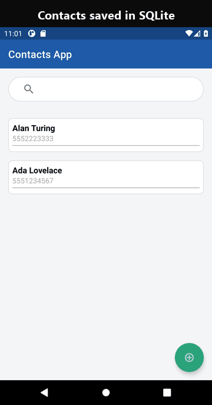
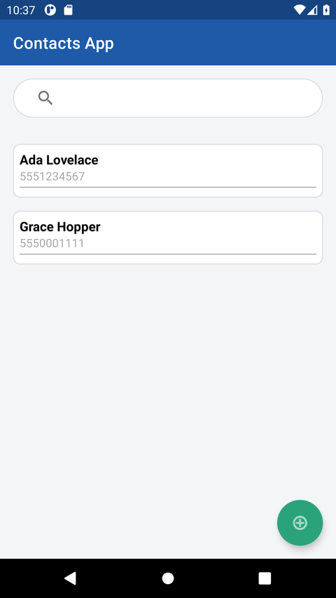
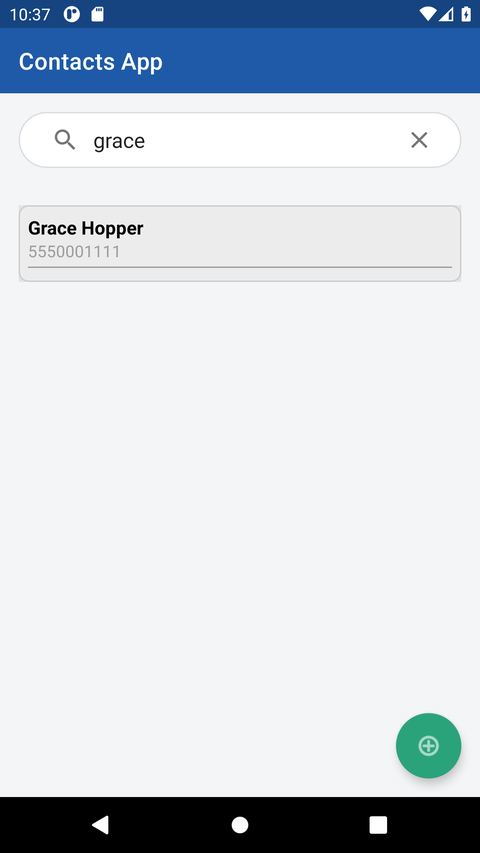
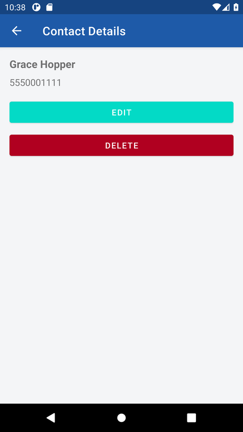

# Mobile Contacts App

An Android contact manager written in Java, with contacts stored in a local SQLite database.

<p align="center">
  
</p>

| Contact list | Live search | Contact details |
|---|---|---|
|  |  |  |

## Try it

- **On an Android phone:** download `ContactsApp.apk` from the
  [latest release](https://github.com/SanellaPalangic2/Mobile-Contacts-App/releases/latest),
  open it, and allow installs from your browser when Android asks. Requires Android 8.0 or newer.
- **In a browser, no phone needed:** upload the same APK to [Appetize.io](https://appetize.io)
  to get a shareable link that runs the app in an emulator in the browser.
- **From source:** see [Build and run](#build-and-run).

## Features

- **Contact list.** All saved contacts are shown in a scrolling list (RecyclerView).
- **Live search.** Typing in the search bar filters the list by name or phone number as you type.
- **Add.** The **+** button opens a dialog to enter a name and phone number; both are required.
- **Details, edit, delete.** Tapping a contact opens a detail screen with:
  - **Edit**: opens the same dialog pre-filled, saves the changes, and returns to the list.
  - **Delete**: asks for confirmation, removes the contact, and returns to the list.

## How it works

| File | Role |
|---|---|
| `MainActivity.java` | List screen: search, add dialog, launches the detail screen and refreshes on return |
| `ContactDetailActivity.java` | Detail screen: edit and delete, reports the result back to the list |
| `ContactAdapter.java` | RecyclerView adapter; keeps a filtered copy of the list for search |
| `MyDBHandler.java` | `SQLiteOpenHelper` with create, read, update and delete for the `Contacts` table |
| `Contact.java` | Data model (id, name, phone) |

## Build and run

Requirements: Android Studio (or JDK 17 plus the Android SDK), Android 8.0 (API 26) or newer.

1. Clone the repo and open the folder in Android Studio (**File → Open**).
2. Let Gradle sync, then press **Run** with an emulator or a USB-connected phone.

From the command line:

```bash
./gradlew assembleDebug          # Windows: gradlew.bat assembleDebug
adb install -r app/build/outputs/apk/debug/app-debug.apk
```

## Project structure

```
app/src/main/java/com/example/contactsapp/   Java source
app/src/main/res/layout/                    screens, list row, add/edit dialog
app/src/main/res/values/                    theme, colors, strings
app/src/main/AndroidManifest.xml
```
